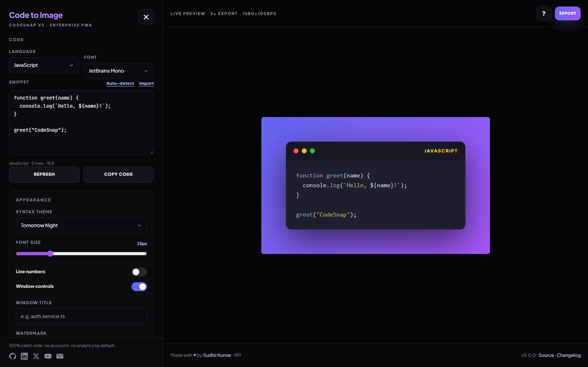
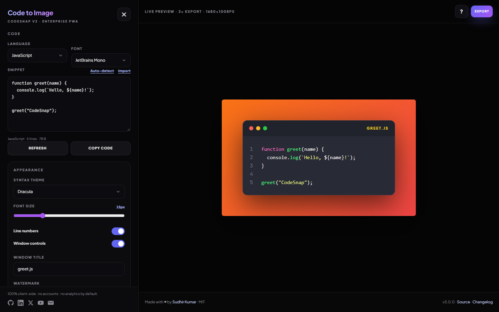
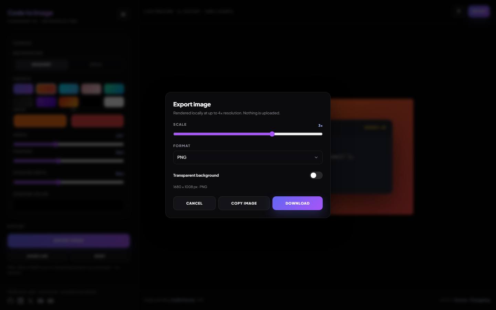
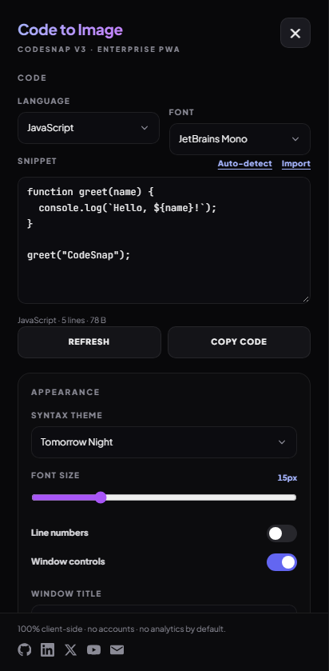

# CodeSnap — code to image generator

Turn a snippet into a clean, high-resolution image without uploading it anywhere.
CodeSnap is a **static, offline-first PWA**: no backend, no account, no tracking
by default.

[](https://github.com/SudhirDevOps1/code-to-image-generator/actions/workflows/ci.yml)
[](https://github.com/SudhirDevOps1/code-to-image-generator/actions/workflows/codeql.yml)
[](https://github.com/SudhirDevOps1/code-to-image-generator/actions/workflows/lighthouse.yml)
[](https://github.com/SudhirDevOps1/code-to-image-generator/actions/workflows/deploy-pages.yml)
[](LICENSE)
[](https://web.dev/progressive-web-apps/)
[](.nvmrc)

**[Live app](https://sudhirdevops1.github.io/code-to-image-generator/)** ·
[Contributing](CONTRIBUTING.md) · [Security](SECURITY.md) · [Changelog](CHANGELOG.md)

---

## Screenshots

| Editor                                                    | Themes and presets                                             |
| --------------------------------------------------------- | -------------------------------------------------------------- |
|  |  |
| **Export dialog**                                         | **Mobile**                                                     |
|   |      |

---

## Why this exists

Most "code to image" tools upload your snippet to a server. CodeSnap renders
entirely in the browser: your code stays on your device, the app keeps working
offline after the first load, and the deployed bundle makes **zero third-party
network requests** at runtime.

---

## Features

### Editor

- 13 languages with automatic detection from filename or content
- 10 monospace fonts, self-hosted (latin subsets, no Google Fonts request)
- 10 curated syntax themes with matching window chrome
- Gradient editor (two colours + angle) and 10 presets, or a solid background
- Font size, padding and shadow controls
- Line numbers, macOS-style window controls, custom window title, watermark
- File import and drag-and-drop anywhere on the preview
- Auto-save to `localStorage`, undo/redo with burst coalescing
- Keyboard shortcuts and an in-app help dialog

### Export

- PNG, JPEG and WebP
- 1–4× scale with a live pixel-dimension estimate
- Quality control for lossy formats, transparent background for PNG/WebP
- Copy the rendered image to the clipboard where supported
- Deterministic filenames: `codesnap-py-20261106-143005.png`
- Guard against browser canvas limits (40 MP) with a clear message instead of a
  blank file

### Sharing

- Compressed `#s=` share links (8,000-character cap)
- Payload is validated and normalised before it reaches the app state
- Links are client-side snapshots — no link shortener, no server registry

### Platform

- Installable PWA with an explicit update prompt
- Offline banner and full offline boot after the first visit
- Responsive layout with a mobile settings drawer
- Accessible controls, native dialogs, visible focus, reduced-motion support
- Strict CSP, no inline scripts, no runtime CDN dependencies

---

## Quick start

Requirements: **Node.js 20.19+** (CI uses Node 22).

```bash
npm ci
npm run dev          # http://localhost:5173
```

Production preview (service worker enabled):

```bash
npm run build
npm run preview      # http://127.0.0.1:4173
```

The app is a static bundle in `dist/`. Serve it over HTTPS (required for service
workers and clipboard access) with a fallback to `index.html`.

---

## Scripts

| Command                 | Purpose                                                |
| ----------------------- | ------------------------------------------------------ |
| `npm run dev`           | Vite dev server with HMR                               |
| `npm run build`         | Generate icons, build `dist/`, emit the service worker |
| `npm run preview`       | Serve the production build locally                     |
| `npm test`              | Unit tests (Vitest)                                    |
| `npm run test:coverage` | Unit tests with V8 coverage                            |
| `npm run test:e2e`      | Playwright desktop + mobile journeys (builds first)    |
| `npm run lint`          | ESLint, Stylelint and html-validate                    |
| `npm run format`        | Prettier write                                         |
| `npm run format:check`  | Prettier check                                         |
| `npm run size`          | Enforce bundle budgets                                 |
| `npm run verify`        | lint → format check → unit tests → build → budgets     |
| `npm run icons`         | Regenerate favicons, PWA icons and the OG image        |
| `npm run screenshots`   | Recapture docs/PWA screenshots from a running preview  |
| `npm run lighthouse`    | Lighthouse CI against `dist/`                          |

First-time browser setup:

```bash
npx playwright install chromium
```

---

## Architecture at a glance

```
index.html → src/main.js → src/js/ui.js → state.js (single source of truth)
                              ├── highlight.js → Prism (bundled)
                              ├── export.js    → html2canvas
                              ├── share.js     → lz-string
                              ├── storage.js   → localStorage
                              └── pwa.js       → Workbox service worker
```

- **Pure core:** state, sharing, detection, rendering helpers and storage are
  dependency-free and unit-tested.
- **One-way dependencies:** pure modules never import the UI or DOM.
- **Untrusted input:** snippets, share links, imported files and saved state all
  pass through `normalizeState` (allow-list, bounds, colour validation).
- **Bundled assets:** fonts, Prism grammars and themes are local; the CSP allows
  `'self'` only.
- **Export constraint:** the capture path uses hex/rgb colours because
  html2canvas cannot parse `oklch()` or `color-mix()`.

Read [docs/ARCHITECTURE.md](docs/ARCHITECTURE.md) for the full module map, data
flow and security model.

---

## Quality gates

Every pull request runs:

| Gate          | Tool                                 | Threshold                 |
| ------------- | ------------------------------------ | ------------------------- |
| JavaScript    | ESLint                               | zero errors               |
| CSS           | Stylelint                            | zero errors               |
| HTML          | html-validate                        | zero errors               |
| Formatting    | Prettier                             | clean                     |
| Unit tests    | Vitest                               | 35 tests, 100% pass       |
| Browser tests | Playwright (Chromium, Pixel 7)       | 14 journeys, 100% pass    |
| JS budget     | `scripts/check-bundle-size.mjs`      | ≤ 260 KB gzip             |
| CSS budget    | `scripts/check-bundle-size.mjs`      | ≤ 60 KB gzip              |
| Total output  | `scripts/check-bundle-size.mjs`      | ≤ 3.4 MB                  |
| Performance   | Lighthouse CI                        | ≥ 0.90 (best of 3 runs)   |
| Accessibility | Lighthouse CI                        | ≥ 0.95                    |
| Security      | CodeQL, Dependency Review, Scorecard | no high/critical findings |

Budgets are deliberate contracts, not targets. Raising one requires a written
justification in the PR.

See [CONTRIBUTING.md](CONTRIBUTING.md) for the local workflow and conventions.

---

## Deployment

### GitHub Pages

1. Settings → Pages → Source: **GitHub Actions**.
2. Push to `main`.
3. `.github/workflows/deploy-pages.yml` builds with
   `VITE_BASE=/<repository-name>/`, enforces budgets and deploys the artifact.

### Any static host

```bash
npm run build
# upload dist/
```

`public/_headers` provides HSTS, `X-Frame-Options`, `Permissions-Policy` and
immutable asset caching on hosts that support it (Netlify, Cloudflare Pages).
GitHub Pages cannot set response headers; the meta CSP in `index.html` still
applies.

### Releases

Tag a commit with `vX.Y.Z`. The release workflow verifies the build, produces
`codesnap-dist.zip` and an SPDX SBOM, attests build provenance, and publishes the
GitHub release.

---

## Security and privacy

- **No backend, no accounts, no cookies, no analytics by default.**
- Snippets, saved state and share fragments never leave the browser.
- Strict CSP; no inline scripts; no third-party runtime origins.
- Dependency Review blocks high/critical advisories; CodeQL and OpenSSF
  Scorecard run continuously.
- Core Web Vitals reporting is opt-in and only enabled when
  `VITE_ANALYTICS_ENDPOINT` is set at build time; it sends aggregate metrics only.
- Share links are **not encrypted**. Anyone with the URL can read the snippet.

Report vulnerabilities privately per [SECURITY.md](SECURITY.md). Do not open a
public issue.

---

## Browser support

| Browser        | Status                                                |
| -------------- | ----------------------------------------------------- |
| Chrome / Edge  | ✅ Primary target, tested in CI                       |
| Android Chrome | ✅ Tested (Pixel 7 profile)                           |
| Safari / iOS   | ✅ Supported; clipboard image copy may be unavailable |
| Firefox        | ✅ Supported; cross-browser CI is on the roadmap      |

Export uses the Canvas API and html2canvas. Very large snippets may exceed device
canvas limits; the dialog warns before rendering and suggests a lower scale.

---

## Documentation

| Document                                                     | Contents                                              |
| ------------------------------------------------------------ | ----------------------------------------------------- |
| [docs/ANALYSIS.md](docs/ANALYSIS.md)                         | Deep audit of v2, findings, severity, remediation     |
| [docs/ARCHITECTURE.md](docs/ARCHITECTURE.md)                 | Modules, state, rendering, export, security, delivery |
| [docs/ROADMAP.md](docs/ROADMAP.md)                           | Prioritised roadmap with acceptance criteria          |
| [docs/OPERATIONS.md](docs/OPERATIONS.md)                     | Runbook, CI/CD, releases, rollback, incidents         |
| [docs/ENTERPRISE-READINESS.md](docs/ENTERPRISE-READINESS.md) | Maturity scorecard, control mapping, gap register     |
| [CONTRIBUTING.md](CONTRIBUTING.md)                           | Setup, conventions, adding languages/themes           |
| [SECURITY.md](SECURITY.md)                                   | Threat model, reporting, dependency policy            |
| [CHANGELOG.md](CHANGELOG.md)                                 | Version history                                       |

---

## Contributing

Contributions are welcome. Please read [CONTRIBUTING.md](CONTRIBUTING.md) and the
[Code of Conduct](CODE_OF_CONDUCT.md), then:

```bash
git checkout -b feat/your-feature
npm run verify
npm run test:e2e
```

Open a PR with a clear description, screenshots for visual changes, and the
rollback path for risky changes.

---

## License

[MIT](LICENSE) © Sudhir Kumar

Built with [Vite](https://vite.dev/), [Tailwind CSS](https://tailwindcss.com/),
[Prism](https://prismjs.com/), [html2canvas](https://html2canvas.hertzen.com/),
[lz-string](https://github.com/pieroxy/lz-string) and
[vite-plugin-pwa](https://vite-pwa-org.netlify.app/). Fonts via
[Fontsource](https://fontsource.org/).
